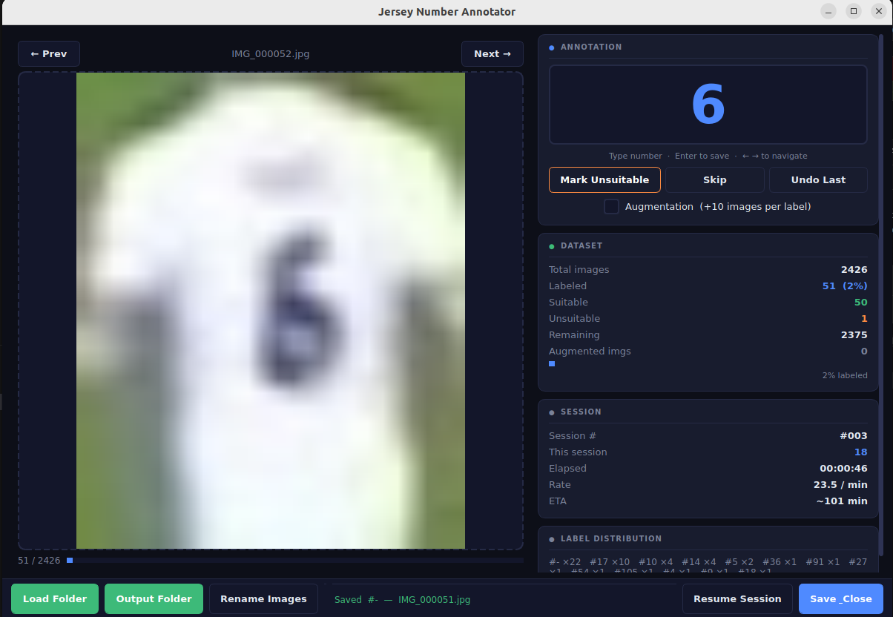

# Jersey Number Annotator

A keyboard-driven desktop tool for labelling football jersey numbers in image crops, built to produce training datasets for OCR and jersey-recognition models.

Developed as part of a Bachelor's final-year project on **automatic football commentary generation**, where a jersey-recognition module required a labelled dataset to map visible shirt numbers to player identities.

---

## Screenshot



> **Note on image quality:** The crops will appear blurry and pixelated — this is expected and is not a fault of the tool. Images are extracted from standard HD broadcast footage (typically 1080p or 720p), and a player's jersey occupies only a small region of the frame. At that scale, a crop of the number region is inherently low resolution. The tool is designed specifically for this domain, and the augmentation pipeline helps compensate by generating additional training variants from each usable crop.

---

## Features

| Feature | Description |
|---|---|
| **Keyboard-driven annotation** | Type the jersey number, press Enter to save and advance — no mouse required |
| **Augmentation mode** | Generates multiple transformed variants per image to expand the training set |
| **Session persistence** | Stop at any time and resume from the last annotated image |
| **Undo support** | Revert the most recent annotation if a mistake is made |
| **CSV export** | Structured output with image name, label, session ID, and timestamp |
| **Live dataset stats** | Real-time display of labeled count, suitable/unsuitable split, label distribution, annotation rate, and ETA |
| **Image renaming** | Built-in dialog to batch-rename images to a consistent naming scheme |

---

## Project Structure

```
JerseyNumberAnnotator/
├── annotator.py              # Main GUI application (entry point)
├── image_loader.py           # Loads images and manages navigation state
├── csv_handler.py            # Reads and writes the annotations CSV
├── augmentor.py              # Generates augmented image variants
├── session_manager.py        # Persists and resumes session history
├── rename_dialog.py          # In-tool dialog for batch-renaming images
├── annotation_service.py     # Orchestrates save/undo across CSV and augmentor
├── assets/                   # Application icons and screenshots
└── inputImages/
    ├── resize50Script.py             # Batch-resize images to 50%
    └── standardRenamingScript.py     # Batch-rename to a standard scheme
```

---

## Installation

**Requirements:** Python 3.8 or later.

Install dependencies:

```bash
pip install PyQt5 opencv-python numpy
```

Clone and run:

```bash
git clone https://github.com/fawwaz-tasneem/JerseyNumberAnnotator.git
cd JerseyNumberAnnotator
python annotator.py
```

---

## Usage

### 1. Set up folders

- Click **Output Folder** first to choose where annotations, augmented images, and session data will be written.
- Click **Load Folder** to select the directory of input image crops.

If the output folder already contains annotations from a previous run, the tool automatically resumes from the first unannotated image.

### 2. Annotate

Type the jersey number using the number keys (`0`–`9`). The number is shown live in the display. Press **Enter** to save and advance. Press **Backspace** to correct a digit.

To mark a crop as **unsuitable** (obscured, misidentified bounding box, number not visible), either click *Mark Unsuitable* or type `-` twice.

### 3. Augmentation (optional)

Enable **Augmentation** before saving. Each saved image will generate the original (suffixed `_aug0`) plus several transformed variants (`_aug1`, `_aug2`, ...), all sharing the same label. This is useful when the dataset is small.

### 4. Session management

Click **Save & Close** to persist the current session and exit. On the next run, select the same output folder to resume. Click **Resume Session** mid-run to start a fresh session counter while retaining all previous annotations.

---

## Keyboard Shortcuts

| Key | Action |
|---|---|
| `←` / `→` | Previous / next image |
| `0` – `9` | Enter a digit of the jersey number |
| `Backspace` | Delete the last digit |
| `Enter` | Save annotation and advance |
| `-` `-` | Mark as unsuitable |

---

## Output

### `annotations.csv`

All annotations are appended to a single CSV in the output folder:

| image_name | label | session_id | timestamp |
|---|---|---|---|
| `IMG_0001.jpg` | `10` | `20250215_020223` | `2025-02-15 02:02:36` |
| `IMG_0001_aug1.jpg` | `10` | `20250215_020223` | `2025-02-15 02:02:38` |
| `IMG_0002.jpg` | `unsuitable` | `20250215_020223` | `2025-02-15 02:04:11` |

The `session_id` field groups all images annotated in the same run, which is useful for auditing or rolling back a session.

### Augmented images

Saved to the output folder alongside the original:

```
IMG_0001_aug0.jpg    # Copy of original
IMG_0001_aug1.jpg    # Augmented variant 1
IMG_0001_aug2.jpg    # Augmented variant 2
...
```

Augmentations include rotation, perspective shift, brightness/contrast adjustment, Gaussian blur, hue shift, random crop-resize, and affine transform.

### `session_history.json`

Tracks per-session statistics (images annotated, suitable count, start/end time) so the tool can report cumulative totals across sessions.

---

## Troubleshooting

**Annotations are not being saved.**
Confirm an output folder has been selected (the status bar at the bottom will confirm it). Ensure the process has write permission to that directory. Run from a terminal (`python annotator.py`) to see any errors printed during save.

**Augmented images are not appearing.**
Enable *Augmentation* before pressing Enter. If `cv2` fails to write an image, the error will be printed to the terminal — this usually indicates a missing or unwritable output path, or an image that could not be decoded by OpenCV.

**Session does not resume.**
Ensure both `annotations.csv` and `session_history.json` are present in the selected output folder, and that the same output folder is selected on the new run. The tool will confirm resumption with a dialog box.

---

## Authors

Developed by **Fawwaz Bin Tasneem** and **Syed Ali Mehdi Rizvi** as part of a Bachelor's final-year project on automatic football commentary generation at Zakir Husain College of Engineering and Technology, Aligarh Muslim University.

---

## License

Released under the MIT License. See [LICENSE](LICENSE) for the full text.
